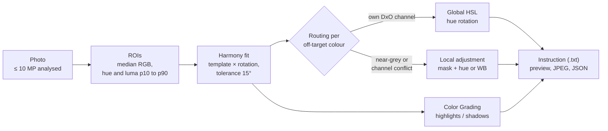

# colorwheel

Single-file web page for colour harmony work on photos. Mark a few areas of a photo, see their hues on a colour wheel, choose a harmony, and get the settings that move the colours into it, written as a colour grading instruction for **DxO PhotoLab 10**. The photo preview shows an approximation of those settings applied.

Everything runs in the browser. No photo is uploaded, no external script, font or stylesheet is loaded, and the page works offline.

## Use

Open `colorwheel.html` in a current browser (Chrome, Firefox, Safari, Edge). It works directly from disk (`file://`); no web server is needed.

1. **Choose photo** (JPEG, PNG or WebP), or drop it on the photo area. Images above 10 MP are analysed and exported at 10 MP; the EXIF orientation is applied.
2. Set the number of **ROIs** (1 to 20, default 5), then drag a rectangle or click a point for each area. The analysis starts after the last one. **Start again** clears them.
3. Pick a **harmony**. The photo updates with the settings applied; **original** shows the untouched photo.
4. Click a colour's **number** to anchor the harmony on that colour; click again to release it.
5. **Custom**: drag the target points on the wheel (Harmony guide view). Dragging a point of any harmony switches to custom with those points. Double-click on the outer ring adds a point (up to 6); double-click on a point removes it.
6. Export the image, the colour grading instruction or the results.

## Workflow



## Colour wheel

Three views:

- **Natural**: each colour at its hue, distance from the centre = HSL saturation.
- **Pure hues**: each colour on the rim at its hue.
- **Harmony guide**: the harmony's target points joined by a dashed outline, and an arrow from every off-target colour to its target.

Hues are HSV/HSL degrees on an RGB wheel, red at 3 o'clock, counterclockwise.

## Harmonies

| Harmony | Sector centres (relative) |
|---|---|
| monochromatic | 0° |
| analogous | −30°, 0°, +30° |
| complementary | 0°, 180° |
| split | 0°, 150°, 210° |
| triadic | 0°, 120°, 240° |
| compound | 0°, 30°, 150°, 180° |
| square | 0°, 90°, 180°, 270° |
| custom | 1 to 6 points set on the wheel |

**Fit.** Every template is tried at every rotation (1° steps), or, with an anchor, only at rotations that put one of its sectors exactly on the anchor colour. A colour within the alignment tolerance of its nearest sector centre counts as aligned; the fit minimises the mean excess beyond the tolerance.

**auto** picks the simplest template (in the table's order) whose excess is within 3° of the best one.

**Score** = 100 × (1 − mean distance / 90°), clipped at 0. This is the tool's own measure, not a published one.

**Compound** uses 0, 30, 150 and 180°. Adobe Color describes compound only in words; its exact angles are not published.

## Per colour

For each ROI the table shows: swatch, editable label, hex, colour family, H, S, L, and the status:

- **Aligned**: within the tolerance
- **Slight nudge toward …**: up to 10° beyond the tolerance
- **Shift toward …**: further out; with the shift in degrees and a suggested target colour (same S and L, target hue)
- **excluded**: saturation below the exclusion threshold

Near-grey colours (saturation below 5 %) get the warning "hue unstable"; they receive a small tint instead of a hue rotation.

## Color Grading Instruction

A text plan for DxO PhotoLab 10, in this order: White Balance and Color Rendering, global HSL, Color Grading, Local Adjustments, compare.

- **Global HSL**: an off-target colour is assigned to the nearest DxO HSL channel (Red 0°, Orange 30°, Yellow 60°, Green 120°, Cyan 180°, Blue 240°, Violet 270°, Magenta 300°). The instruction gives the channel, the ROI to sample with the hue picker, the rotation in degrees, the target, and the share of the image the channel touches.
- **Color Grading**: highlights toward the target hue of the brightest chromatic ROI, shadows toward that of the darkest, when the two differ. Midtones neutral, balance centred.
- **Local Adjustments**: used when a colour is near-grey, or when another ROI in the same HSL channel needs a different shift (more than 10° apart). For each: AI Mask predefined category when the ROI label contains a matching word (sky, flowers, vehicles, people, animals), AI Mask Selection or Control Point with position and radius, Hue Mask (ROI hue p10 to p90), Luminosity Mask (ROI luma p10 to p90), and the correction (local HSL hue, or White Balance temperature and tint for near-grey colours).
- Shifts above 45° get a note that they are likely to look unnatural.

## Parameters

| Parameter | Default | Effect |
|---|---|---|
| Alignment tolerance (deg) | 15 | distance from a sector centre that counts as aligned |
| Strength (0 to 1) | 1 | fraction of each shift applied in the preview and export |
| Exclude colours with saturation below (%) | 0 | such colours are ignored in the fit |
| Anchor the harmony on the most saturated colour | on | locks the fit on that colour after analysis |

## Export

| Button | File | Content |
|---|---|---|
| Export image | `<name>_graded.jpg` | the photo with the settings applied (approximation), at the analysed size (≤ 10 MP), JPEG quality 0.92, a "Copyright wjst.de" JPEG comment |
| Color Grading Instruction | `<name>_color_grading_instruction.txt` | the instruction text |
| Download results (.json) | `<name>_wheel.json` | source file, original and analysed size, ROI boxes in original pixels, per colour (RGB, hex, HSL, family, target hue, shift, status, ROI statistics), harmony with ranking of all templates, routing (global, local, grading, channel conflicts), channel coverage, parameters |

## How the preview is computed

The preview imitates the instruction on the photo; it is not DxO's rendering.

- **Global HSL**: hue rotation per pixel, weighted by the pixel's hue distance from the colour (full within 25°, fading over 15° more) and by its saturation.
- **Color Grading**: shift of a* and b* in CIELAB, weighted by lightness (highlights above L* 50, shadows below).
- **Local**: a soft spatial region around the ROI, multiplied by a Gaussian of the CIELAB distance to the ROI colour, smoothed with a box blur.

## Limitations

- DxO's HSL channel centres, slider scaling and the sign of the local Hue slider are not verified. Check the result in DxO, and sample with the eyedroppers.
- Harmony fit, score, tolerance and the routing into global HSL, colour grading and local masks are this tool's own rules, not DxO's.
- The ROI colour is the per-channel median, so an ROI spanning two different colours gives a colour between them. Keep ROIs on uniform areas.
- Images are analysed and exported at no more than 10 MP; the exported JPEG is not a substitute for a DxO export of the raw file.
- Exported JPEGs carry no EXIF or colour profile from the original.

## Files

```
colorwheel.html   the complete tool (HTML, CSS, JavaScript in one file)
```

## License

CC BY-NC 4.0, see [LICENSE](LICENSE).

## Author

Matthias Wjst, [wjst.de](https://www.wjst.de)
